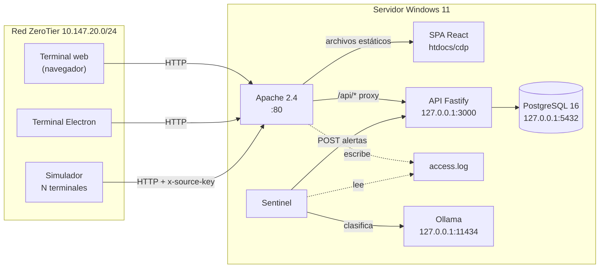
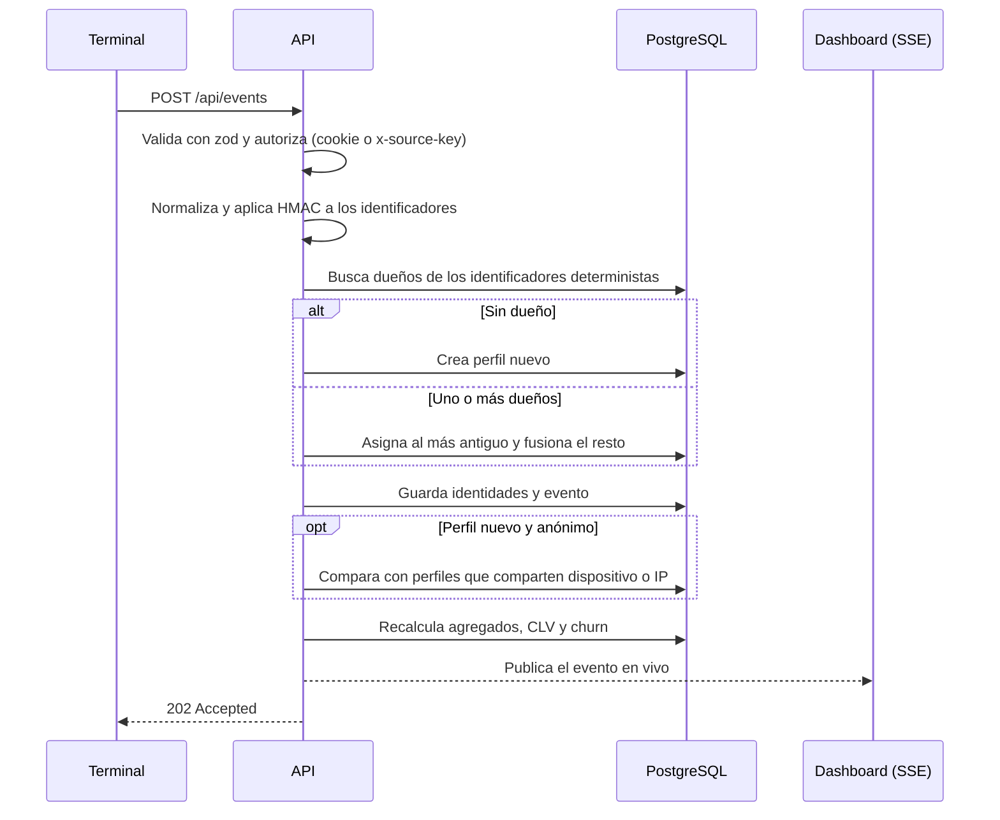
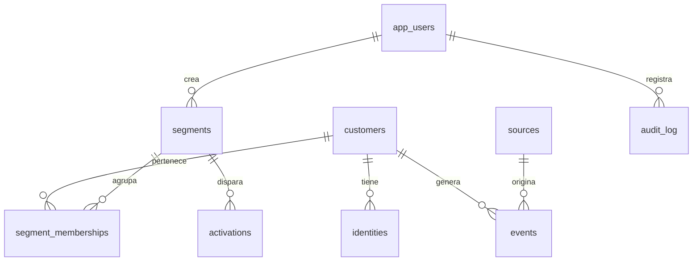

# CDP FKPS · Customer Data Platform

[](https://github.com/facu100201/Customer-Data-Platform---FKPS/actions/workflows/ci.yml)
[](https://github.com/facu100201/Customer-Data-Platform---FKPS/actions/workflows/security.yml)


Plataforma de datos de clientes (CDP) construida por el equipo FKPS. Recibe eventos de muchas terminales
conectadas por una red privada ZeroTier, une los fragmentos de cada persona en un perfil único, calcula su
valor y su riesgo de abandono, la agrupa en segmentos y decide qué mensaje o banner debe recibir.
Todo corre en un servidor Windows con Apache 2.4, PostgreSQL y un modelo de IA local para vigilar la
seguridad.

---

## Contenido

1. [Resumen ejecutivo](#1-resumen-ejecutivo)
2. [El problema](#2-el-problema)
3. [Qué hace el sistema](#3-qué-hace-el-sistema)
4. [Arquitectura](#4-arquitectura)
5. [Modelos y algoritmos](#5-modelos-y-algoritmos)
6. [Roles y permisos](#6-roles-y-permisos)
7. [Seguridad](#7-seguridad)
8. [Modelo de datos](#8-modelo-de-datos)
9. [API](#9-api)
10. [Estructura del repositorio](#10-estructura-del-repositorio)
11. [Puesta en marcha](#11-puesta-en-marcha)
12. [Pruebas y calidad](#12-pruebas-y-calidad)
13. [CI/CD y despliegue](#13-cicd-y-despliegue)
14. [Decisiones de arquitectura](#14-decisiones-de-arquitectura)
15. [Estado actual y limitaciones](#15-estado-actual-y-limitaciones)
16. [Equipo y forma de trabajo](#16-equipo-y-forma-de-trabajo)

---

## 1. Resumen ejecutivo

| | |
| --- | --- |
| **Objetivo** | Construir un CDP funcional servido por Apache y accesible solo por ZeroTier, con más de 20 terminales ligeras (*dumb terminals*) generando datos al mismo tiempo. |
| **Resultado** | Monorepo TypeScript con API, web, app de escritorio, motor de cálculo, monitor de seguridad con IA local y simulador de carga. CI completo en GitHub Actions. |
| **Capacidades** | Ingesta de 4 tipos de datos · resolución de identidad determinista y probabilística · perfil 360 · CLV y churn · segmentos por reglas · activaciones simuladas · personalización web en tiempo real. |
| **Usuarios** | 4 roles: usuario, QA, admin y superusuario, con permisos distintos en la API y en la interfaz. |
| **Infraestructura** | Windows 11 + Apache 2.4.69 (proxy y archivos estáticos) + Node.js 22 + PostgreSQL 16 + Ollama (`llama3.2:3b`), todo dentro de la red ZeroTier `10.147.20.0/24`. |
| **Calidad** | Lint, formato, typecheck, pruebas unitarias (Vitest), E2E con 20 navegadores concurrentes (Playwright), prueba de carga con 25 terminales simuladas, CodeQL, gitleaks y `npm audit`. |

## 2. El problema

Una misma persona deja rastros en varios lugares y nadie los conecta:

1. Navega de forma anónima desde su teléfono y abandona un carrito.
2. Días después compra desde su laptop y deja su correo.
3. Más tarde llama a soporte y da su teléfono.

Sin un CDP, la empresa ve a tres clientes distintos. Así, le manda un cupón de "vuelve por tu carrito" a quien
ya compró, y no sabe que su cliente más valioso está a punto de irse. El CDP reconoce que los tres
fragmentos son la misma persona y mantiene un solo perfil que se actualiza con cada evento.

## 3. Qué hace el sistema

El proyecto cubre las cuatro capacidades de un CDP descritas en [`docs/objetivo.md`](docs/objetivo.md).

### 3.1 Recolección de datos

Cada terminal manda eventos a `POST /api/events`, uno por uno o en lotes de hasta 500. Cada evento declara
una de cuatro categorías:

| Categoría | Ejemplos |
| --- | --- |
| `behavior` | `page_view`, `product_view`, `add_to_cart`, `cart_abandoned`, `app_open` |
| `transaction` | `purchase`, `refund`, `subscription_renewed` |
| `profile` | `identify`, `preferences_updated` |
| `operational` | `support_ticket`, `chat_started`, `shipment_update` |

Hay tres tipos de origen:

- **Terminal web**: el navegador de un usuario autenticado. Si se cae la red, guarda los eventos en IndexedDB y los reenvía en lotes de 100 cuando vuelve la conexión.
- **Terminal de escritorio**: una app Electron que solo abre la terminal web. No guarda datos ni ejecuta lógica.
- **Fuentes con llave**: el simulador o una integración que se identifica con `x-source-key`. Sus perfiles se marcan como sintéticos.

Cada terminal manda un *heartbeat* cada 20 s. Se considera en línea si se reportó en los últimos 60 s.

### 3.2 Unificación de identidad

Cada evento trae una cookie anónima y, a veces, un correo, teléfono, id de CRM o id de dispositivo. El
motor los normaliza (minúsculas, alias de Gmail, teléfono en formato E.164 con +52 por omisión), los cifra
con HMAC-SHA256 y una pimienta secreta, y busca a quién pertenecen:

- **Determinista**: si el correo, teléfono, id de CRM o cookie ya pertenece a uno o más perfiles, el evento se asigna al más antiguo y los demás se fusionan con él automáticamente.
- **Probabilística**: un perfil nuevo que solo trae cookie se compara con los que comparten dispositivo o IP. Según el puntaje, se fusiona solo, queda en una cola de revisión humana o se descarta (ver [§5.1](#51-coincidencia-probabilística)).

Cada fusión queda registrada en `identity_merges` con su regla, puntaje y motivos.

### 3.3 Segmentación y analítica

Con cada evento se recalculan 13 indicadores del perfil, entre ellos gasto, pedidos, sesiones, tickets,
días desde la última compra o apertura de la app, CLV y probabilidad de churn. Los segmentos se definen
como reglas JSON sobre esos campos:

```json
{
  "all": [
    { "field": "spend_30d", "op": "gt", "value": 100 },
    { "field": "days_since_app_open", "op": "gte", "value": 14 }
  ]
}
```

Los operadores son `eq`, `neq`, `gt`, `gte`, `lt`, `lte` y `exists`, y se combinan con `all`, `any` y `not`
anidados. El ejemplo es el segmento "Gastadores inactivos en app" que crea el seed.

El dashboard muestra perfiles, eventos de las últimas 24 h por hora y por categoría, la distribución de CLV,
las terminales en línea y un feed en vivo por Server-Sent Events.

### 3.4 Activación

El CDP decide **a quién** y **qué** enviar. Los destinos de este proyecto son simulados: registran la
audiencia y una muestra de perfiles, pero no se conectan con servicios externos.

| Destino | Simula |
| --- | --- |
| `email_mock` | HubSpot o Salesforce |
| `ads_mock` | Meta Ads o Google Ads |
| `webhook` | Integración genérica |
| `web_personalization` | **Funciona de verdad**: `GET /api/personalize/:anonymousId` devuelve el banner del segmento al que pertenece el visitante, y la terminal lo muestra en tiempo real. |

### 3.5 Monitoreo de seguridad con IA local

El **Sentinel** lee cada minuto lo nuevo de `access.log` de Apache y los logins fallidos de la API. Primero
aplica reglas deterministas:

- path traversal
- SQL injection
- XSS
- escáneres (`wp-admin`, `.env`, `.git`)
- tráfico de fuera de ZeroTier
- ráfagas de errores 4xx y 5xx
- fuerza bruta

Solo lo sospechoso se envía a **Ollama** (`llama3.2:3b`, en `127.0.0.1`) para que clasifique la severidad y
escriba un resumen en español. Si Ollama está apagado, la alerta se guarda igual con la severidad de las
reglas. Los logs nunca salen del servidor.

## 4. Arquitectura



Solo Apache escucha en la red, y además solo acepta la subred ZeroTier. La API, PostgreSQL y Ollama
escuchan en `127.0.0.1`, y el firewall de Windows bloquea sus puertos desde fuera.

### Flujo de un evento



### Stack

| Capa | Tecnología |
| --- | --- |
| Interfaz | React 18, Vite 7, Tailwind CSS 4, React Router 7, Recharts |
| Datos locales | IndexedDB con Dexie (cola offline de la terminal) |
| Escritorio | Electron 45 + electron-builder (instalador NSIS) |
| API | Node.js 22, Fastify 5, zod 4, `@fastify/jwt`, Argon2 |
| Motor de cálculo | TypeScript puro, sin dependencias de infraestructura |
| Base de datos | PostgreSQL 16 con Prisma 6 |
| IA de seguridad | Ollama con `llama3.2:3b` |
| Servidor web | Apache 2.4.69 (Apache Lounge) como proxy inverso |
| Red | ZeroTier |
| Pruebas | Vitest 4, Playwright |
| CI/CD | GitHub Actions, CodeQL, gitleaks, Dependabot |

## 5. Modelos y algoritmos

Toda la lógica de cálculo vive en [`backend/engine`](backend/engine). Son funciones puras, fáciles de
probar y de revisar.

### 5.1 Coincidencia probabilística

| Señal | Peso |
| --- | --- |
| Mismo `device_id` | 0.45 |
| Misma IP (o misma subred /24) | 0.20 (0.10) |
| Mismo user-agent | 0.10 |
| Actividad en la misma ventana de 30 min | 0.10 |
| Intereses similares (Jaccard × 0.15) | hasta 0.15 |

| Puntaje | Decisión |
| --- | --- |
| ≥ 0.85 | Fusión automática |
| 0.60 – 0.85 | Queda en revisión humana (pantalla *Identidades*) |
| < 0.60 | Se descarta |

Ninguna señal sola alcanza el umbral de fusión automática: hacen falta al menos dos señales fuertes.

### 5.2 Valor del ciclo de vida (CLV)

```
CLV = ticket promedio × compras por mes × 24 meses de vida × 30 % de margen
```

Las compras por mes salen de los últimos 30 días. Si no hubo ninguna, se usa el total repartido entre los
meses de antigüedad del cliente.

### 5.3 Probabilidad de abandono (churn)

Es un modelo logístico, `p = 1 / (1 + e^(−z))`, con:

```
z = −2.0
    + 0.08 × días desde el último evento   (tope 180)
    − 0.60 × pedidos en 30 días
    − 0.15 × sesiones en 30 días           (tope 30)
    + 0.35 × tickets de soporte en 30 días
    + 0.20 × carritos abandonados en 30 días
```

Los coeficientes son supuestos razonables, no entrenados con datos reales (ver [§15](#15-estado-actual-y-limitaciones)).

## 6. Roles y permisos

Los permisos se definen una sola vez en [`shared/src/roles.ts`](shared/src/roles.ts). La API y la interfaz
usan esa misma tabla.

| Permiso | Usuario | QA | Admin | Superusuario |
| --- | :-: | :-: | :-: | :-: |
| Ver dashboard, clientes, segmentos y terminales | ✓ | ✓ | ✓ | ✓ |
| Registrar eventos (terminal) | ✓ | | ✓ | ✓ |
| Ver datos personales sin enmascarar | | | ✓ | ✓ |
| Crear segmentos y activaciones | | | ✓ | ✓ |
| Revisar fusiones de identidad | | | ✓ | ✓ |
| Ver alertas de seguridad | | | ✓ | ✓ |
| Atender alertas de seguridad | | | | ✓ |
| Ver la auditoría | | ✓ | ✓ | ✓ |
| Administrar cuentas "usuario" | | | ✓ | ✓ |
| Cambiar roles | | | | ✓ |

Además, QA solo ve perfiles sintéticos, y quien no tiene permiso de PII ve los rasgos personales como `***`.

## 7. Seguridad

| Capa | Medida |
| --- | --- |
| Red | Apache acepta solo la subred ZeroTier. El firewall abre el puerto 80 solo a esa subred y bloquea 3000, 5432 y 11434. |
| Apache | `ServerTokens Prod`, sin listado de directorios, CSP estricta, `X-Frame-Options DENY`, `nosniff` y límite de 1 MB por petición. |
| Sesión | JWT en cookie `httpOnly` con `SameSite=Strict` y duración de 8 h. La interfaz nunca ve el token. |
| Contraseñas | Argon2. Un correo inexistente tarda lo mismo que uno real, así que no se pueden enumerar cuentas. |
| Abuso | 10 intentos de login por minuto por IP y límite global de 5000 peticiones por minuto. |
| Datos personales | Los identificadores se guardan como HMAC con pimienta, junto a una versión enmascarada. Los rasgos personales se ocultan según el rol. |
| Base de datos | Dos roles: `cdp_migrator` es dueño del esquema y `cdp_app` solo puede leer y escribir datos (ver [`db/postgres/setup.sql`](db/postgres/setup.sql)). |
| Auditoría | Logins, logins fallidos, vistas de PII, fusiones, segmentos, activaciones y cambios de usuarios quedan en `audit_log`. |
| Repositorio | Secretos fuera del código (`.env`), gitleaks sobre todo el historial, CodeQL y `npm audit` bloqueante en dependencias de producción. |

## 8. Modelo de datos

El esquema está en [`db/prisma/schema.prisma`](db/prisma/schema.prisma) y las migraciones en
[`db/prisma/migrations`](db/prisma/migrations).



| Tabla | Contenido |
| --- | --- |
| `customers` | Perfil unificado: rasgos, agregados, CLV, churn, si es sintético, primera y última actividad |
| `identities` | Identificadores (HMAC + enmascarado) con tipo, confianza y fuente |
| `events` | Todos los eventos con categoría, terminal, fecha y payload |
| `identity_merges` | Historial de fusiones: ganador, perdedor, regla, puntaje, motivos y estado |
| `segments`, `segment_memberships` | Reglas y quién cumple cada una |
| `activations` | Destino, configuración y resultado de la última ejecución |
| `sources` | Fuentes con llave (hash SHA-256) |
| `terminals` | Último heartbeat, IP ZeroTier y user-agent |
| `app_users`, `audit_log` | Cuentas, roles y bitácora |
| `security_alerts` | Alertas del Sentinel |

## 9. API

Todas las rutas cuelgan de `/api`.

| Método y ruta | Permiso | Descripción |
| --- | --- | --- |
| `GET /health` | público | Estado de la API y de la base de datos |
| `POST /auth/login` · `POST /auth/logout` · `GET /auth/me` | — | Sesión |
| `POST /events` | `events:write` o llave de fuente | Ingesta (un evento o `{ events: [...] }`) |
| `POST /terminals/heartbeat` · `GET /terminals` | ingesta · `terminals:read` | Terminales |
| `GET /stats/overview` · `GET /stream` | `dashboard:read` · sesión | Dashboard y SSE en vivo |
| `GET /customers` · `GET /customers/:id` | `customers:read` | Lista paginada y perfil 360 |
| `GET /merges` · `POST /merges/:id/approve\|reject` | `merges:review` | Revisión de identidades |
| `GET/POST/DELETE /segments` · `POST /segments/:id/refresh` · `GET /segments/:id/members` | `segments:*` | Segmentos |
| `GET/POST /activations` · `POST /activations/:id/run` | `activations:write` | Activaciones |
| `GET /personalize/:anonymousId` | público en ZeroTier | Banner para el visitante |
| `GET/POST /security/alerts` · `POST /security/alerts/:id/ack` · `GET /security/signals` | `security:*` o token del Sentinel | Seguridad |
| `GET /audit` · `GET /users` · `PATCH /users/:id` | `audit:read` · `users:manage` | Administración |

## 10. Estructura del repositorio

Es un monorepo con npm workspaces.

```
frontend/
  web/          @cdp/web           Interfaz React: dashboard, terminal, clientes, segmentos, operación
  desktop/      @cdp/desktop       Terminal ligera en Electron
backend/
  api/          @cdp/api           API Fastify: auth, RBAC, ingesta, SSE
  engine/       @cdp/engine        Identidad, agregados, segmentación, CLV y churn (funciones puras)
  sentinel/     @cdp/sentinel      Monitor de logs de Apache con reglas y Ollama
  simulator/    @cdp/sim-terminals Generador de journeys de N terminales
db/             @cdp/db            Esquema Prisma, migraciones, seed y setup de PostgreSQL
shared/         @cdp/shared        Roles, esquemas de eventos y segmentos (zod) compartidos
e2e/                               Pruebas Playwright
infra/
  apache/                          VirtualHost del CDP
  ollama/                          Instalación del modelo local
  windows/                         Despliegue, servicios NSSM, firewall, desactivar IIS
docs/                              Objetivo del proyecto y reporte de Apache
.github/                           Workflows, plantilla de PR, Dependabot, CODEOWNERS
```

## 11. Puesta en marcha

### Requisitos

- Node.js 22 (ver [`.nvmrc`](.nvmrc))
- PostgreSQL 16, local o en Docker
- Opcional: Ollama, para que el Sentinel clasifique con IA

### Desarrollo local

```bash
npm ci

# Base de datos de desarrollo con Docker
docker run -d --name cdp-pg -e POSTGRES_USER=cdp -e POSTGRES_PASSWORD=cdp -e POSTGRES_DB=cdp -p 5432:5432 postgres:16

# Variables: copia la plantilla y llena los valores
cp .env.example backend/api/.env
cp .env.example db/.env

npm run db:migrate
npm run db:seed

npm run dev:api    # http://127.0.0.1:3000
npm run dev:web    # http://127.0.0.1:5173
```

Entra con cualquiera de los cuatro usuarios definidos en `SEED_*_EMAIL` / `SEED_*_PASSWORD`. Las
contraseñas deben tener al menos 12 caracteres.

### Generar tráfico

```bash
npm run sim -- --url http://127.0.0.1:3000 --terminals 25 --minutes 2
npm run sim -- --terminals 25 --dry-run      # solo valida los eventos contra el esquema
```

### Comandos

| Comando | Qué hace |
| --- | --- |
| `npm run lint` | ESLint en todo el monorepo |
| `npm run format` / `format:check` | Aplica o verifica Prettier |
| `npm run typecheck` | `tsc` en cada workspace |
| `npm test` / `test:coverage` | Pruebas unitarias con Vitest |
| `npm run test:e2e` | Playwright (requiere Postgres con migraciones y seed) |
| `npm run build` | Compila api, sentinel y web |
| `npm run db:generate` / `db:migrate` / `db:seed` | Cliente Prisma, migraciones y datos iniciales |
| `npm run dev:api` / `dev:web` / `dev:sentinel` | Servidores de desarrollo |

## 12. Pruebas y calidad

| Nivel | Qué cubre |
| --- | --- |
| Unitarias (Vitest) | Motor de identidad, normalización, segmentación, CLV y churn; reglas del Sentinel; candado por llave; autenticación y RBAC de la API sin base de datos; journeys del simulador |
| E2E (Playwright) | Login y credenciales inválidas, navegación por rol, acceso denegado por URL, **20 navegadores concurrentes** que generan eventos e identifican clientes distintos |
| Carga | El simulador manda los journeys de 25 terminales durante 30 s y falla si hay eventos rechazados o errores de red |

## 13. CI/CD y despliegue

| Workflow | Cuándo corre | Qué hace |
| --- | --- | --- |
| [`ci.yml`](.github/workflows/ci.yml) | PR y push a `main` | Lint, formato, tipos, pruebas con cobertura y build. Luego E2E con Postgres 16 y prueba de carga. |
| [`security.yml`](.github/workflows/security.yml) | PR, push y cada lunes | `npm audit`, CodeQL, revisión de dependencias y gitleaks sobre el historial |
| [`deploy.yml`](.github/workflows/deploy.yml) | Cuando CI pasa en `main` | Runner propio en el servidor: build, migraciones, seed, publicación en Apache, reinicio de servicios y prueba de humo |
| [`release-desktop.yml`](.github/workflows/release-desktop.yml) | Tags `v*` | Instalador `.exe` de la terminal de escritorio |

El despliegue en el servidor lo hace [`infra/windows/deploy.ps1`](infra/windows/deploy.ps1). La API y el
Sentinel corren como servicios de Windows mediante NSSM ([`install-services.ps1`](infra/windows/install-services.ps1)).
El deploy nunca corre en pull requests, porque el runner es una máquina real dentro de la red ZeroTier.

## 14. Decisiones de arquitectura

| Decisión | Por qué |
| --- | --- |
| PostgreSQL propio en lugar de Firebase o Supabase | El requisito es servir todo desde el servidor Apache dentro de ZeroTier, sin datos de clientes en servicios externos. |
| Apache como proxy en lugar de Vercel | Cumple con la práctica de Apache endurecido y mantiene la app fuera de internet. |
| Terminales "tontas" | La lógica y los datos viven en el servidor. La terminal solo captura eventos, así que cualquier navegador o la app Electron sirven. |
| Motor de cálculo separado | Las reglas de identidad, segmentación y puntajes se prueban sin base de datos y se pueden revisar de forma aislada. |
| Sesión en cookie `httpOnly` | El JavaScript de la página nunca toca el token. |
| IA local con Ollama | Los logs de seguridad no salen del servidor, y si el modelo falla las alertas siguen saliendo por reglas. |

## 15. Estado actual y limitaciones

**Funciona de punta a punta:** ingesta, cola offline, unificación de identidad, perfil 360, CLV y churn,
segmentos, activaciones simuladas, personalización web, dashboard en vivo, Sentinel, roles y auditoría.

**Limitaciones conocidas:**

- Los destinos de activación son simulados, y los coeficientes de CLV y churn no se entrenaron con datos reales.
- Cada IP o `device_id` queda asignado solo al primer perfil que lo usa (restricción única por tipo y valor). Por eso la coincidencia probabilística compara únicamente contra ese perfil.
- Los segmentos no se recalculan solos: hay que pedirlo desde la interfaz o con `POST /segments/:id/refresh`.
- La API corre como un solo proceso: el candado que evita perfiles duplicados vive en memoria.
- La sesión no se revoca al desactivar un usuario ni al cambiarle el rol, sino hasta que expira (8 h).
- Todavía no hay pantallas para administrar usuarios ni para cambiar la contraseña.

## 16. Equipo y forma de trabajo

**Equipo FKPS:** Pamela Ruíz Velasco, Ana Karen López Jiménez, Fernando Acuña Martínez y Frida Sofía
Escamilla Olguín.

Cada cambio entra por pull request con la [plantilla](.github/PULL_REQUEST_TEMPLATE.md). Esta es la
secuencia:

1. **Diseño**: especificación con criterios de aceptación.
2. **Desarrollo**: implementación en una rama propia.
3. **Revisión**: documentada en Obsidian.
4. **QA**: revisión de código y prueba con el rol QA en Playwright.
5. **Merge**: CI en verde y aprobación del dueño del repositorio (CODEOWNERS).
